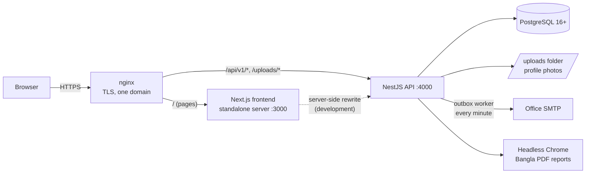

# BBS Meeting Schedule System

An office-wide web application for the Bangladesh Bureau of Statistics (BBS) and the Statistics &
Informatics Division (SID). Every officer creates and manages meetings. Each meeting carries a
**priority taken from the organizer's designation**: a higher-priority meeting is never blocked by a
clash; the organizers and officers of the lower-priority meetings are notified to cancel or reschedule.
Officers have a dashboard and day / week / month / year / fiscal-year reports (with Bangla PDF);
admins manage users, designations, wings, change requests, office reports, the mail queue and the
audit log. The UI is in Bangla.

| Document | Contents |
|---|---|
| [`SPEC.md`](SPEC.md) | Rules, data model, API list, security requirements (source of truth) |
| [`docs/API.md`](docs/API.md) | Every endpoint (generated from `docs/openapi.json`) |
| [`docs/ERD.md`](docs/ERD.md) | Database diagram |
| [`docs/SECURITY.md`](docs/SECURITY.md) | SPEC §9 item by item: where implemented, how tested |
| [`backend/README.md`](backend/README.md) | Backend details (scripts, tests, seeds) |
| [`frontend/README.md`](frontend/README.md) | Frontend details (proxy, Playwright) |

---

## 1. Architecture



- **Frontend** (`frontend/`): Next.js 16, React 19, Tailwind. Talks only to `/api/v1` on the same origin;
  the session lives in httpOnly cookies set by the backend (no token in JavaScript).
- **Backend** (`backend/`): NestJS 11, TypeORM migrations, JWT access + refresh tokens, argon2id,
  conflict engine with advisory locks, mail outbox, cron jobs, Puppeteer PDFs.
- **Database**: PostgreSQL. Times are stored in UTC; days, weeks, months and years are computed in Asia/Dhaka.

## 2. Run locally (development)

Requirements: Node.js 24, PostgreSQL 16+ (macOS: `brew install node@24 postgresql@17`).

```bash
# 1. Databases (once, as the PostgreSQL admin):
#    CREATE ROLE bbs_meeting LOGIN PASSWORD '<strong password>';
#    CREATE DATABASE bbs_meeting      OWNER bbs_meeting;
#    CREATE DATABASE bbs_meeting_test OWNER bbs_meeting;

# 2. Backend
cd backend
npm install
cp .env.example .env              # fill in DB_PASSWORD, JWT secrets, SEED_SUPER_ADMIN_PASSWORD,
cp .env.test.example .env.test    # DEFAULT_OFFICER_PASSWORD (see backend/README.md §1.3)
npm run migration:run
npm run seed                      # designations, wings, super admin, officers from the git-ignored CSV
npm run start:dev                 # http://localhost:4000/api/v1, Swagger at /api/docs

# 3. Frontend (second terminal)
cd frontend
npm install
cp .env.example .env.local        # BACKEND_URL=http://localhost:4000
npm run dev                       # http://localhost:3000
```

First login: `admin@bbs.gov.bd` with `SEED_SUPER_ADMIN_PASSWORD`; the app then asks for a new password.
Officers log in with their official email and the office default password (`DEFAULT_OFFICER_PASSWORD`).

## 3. Tests

| Where | Command | What |
|---|---|---|
| backend | `npm run lint` | ESLint + Prettier |
| backend | `npm run test` | unit tests (Jest, mocks) |
| backend | `npm run test:e2e` | API end-to-end tests on the separate `bbs_meeting_test` database |
| frontend | `npm run lint` / `npm run typecheck` | ESLint / route types + TypeScript |
| frontend | `npm run build` | production build |
| frontend | `npm run test:e2e` | Playwright in Chromium against the running backend (`MAIL_DRY_RUN=true`); needs `frontend/.env.e2e` with an admin login. Uses only test accounts ending in `@example.com` |

## 4. Production deployment (one Linux server)

The example uses Ubuntu 24.04, the domain `meeting.bbs.gov.bd`, the system user `bbsmeeting` and the
folder `/opt/bbs-meeting`. Adjust names to your server.

### 4.1 Packages and user

```bash
sudo apt update
sudo apt install -y postgresql nginx certbot python3-certbot-nginx git
# Node.js 24 (NodeSource or the official tarball), then:
node -v                                   # v24.x
# Libraries headless Chrome needs for the PDF reports:
sudo apt install -y libnss3 libatk-bridge2.0-0 libgbm1 libxkbcommon0 libasound2t64 libgtk-3-0 fonts-noto-core
sudo adduser --system --group --home /opt/bbs-meeting bbsmeeting
```

The app runs as this normal user, never as root (the Chrome sandbox stays on).

### 4.2 PostgreSQL

```bash
sudo -u postgres psql <<'SQL'
CREATE ROLE bbs_meeting LOGIN PASSWORD '<strong password>';
CREATE DATABASE bbs_meeting OWNER bbs_meeting;
SQL
```

PostgreSQL listens only on localhost (default). No test database is needed on the server.

### 4.3 Get and build the code

```bash
sudo -u bbsmeeting -H bash
cd /opt/bbs-meeting
git clone https://github.com/tusherdd/meeting-MS-bbs.git app
cd app && git checkout v1.0

cd backend
npm ci
npx puppeteer browsers install chrome    # Chrome for PDFs (in ~/.cache/puppeteer of this user)
cp .env.example .env && chmod 600 .env   # then edit, see 4.4
npm run build

cd ../frontend
npm ci
echo "BACKEND_URL=http://127.0.0.1:4000" > .env.local
npm run build                             # output: .next/standalone
cp -r public .next/standalone/ && cp -r .next/static .next/standalone/.next/
```

### 4.4 Backend settings (`backend/.env`)

| Variable | Production value |
|---|---|
| `NODE_ENV` | `production` |
| `PORT` | `4000` (only reachable through nginx) |
| `APP_URL` | `https://meeting.bbs.gov.bd` |
| `FRONTEND_URL`, `CORS_ORIGINS` | `https://meeting.bbs.gov.bd` |
| `DB_*` | the database from 4.2 |
| `JWT_ACCESS_SECRET`, `JWT_REFRESH_SECRET` | two different values from `openssl rand -base64 48` |
| `SMTP_HOST`, `SMTP_PORT`, `SMTP_SECURE`, `SMTP_USER`, `SMTP_PASSWORD`, `MAIL_FROM` | the office SMTP server |
| `MAIL_DRY_RUN` | `false` (mail is really sent; must be set explicitly in production) |
| `SCHEDULER_ENABLED` | `true` (mail worker, cleanups, auto-complete) |
| `UPLOAD_DIR` | `/opt/bbs-meeting/uploads` (outside the code folder; create it, owned by `bbsmeeting`) |
| `TRUST_PROXY` | `true` behind nginx (or `1` = one proxy hop) so rate limits and the audit log see the real client IP |
| `THROTTLE_LIMIT`, `THROTTLE_USER_LIMIT` | defaults 100 per IP / 300 per logged-in user per minute |
| `SWAGGER_ENABLED` | `false` (or `true` with `SWAGGER_USER` / `SWAGGER_PASSWORD`) |
| `SEED_SUPER_ADMIN_PASSWORD` | initial password of `admin@bbs.gov.bd` (only used by the seed) |
| `DEFAULT_OFFICER_PASSWORD` | the office default officer password (letters + digits, ≥ 8). Never commit or mail it |

The API refuses to start with unsafe production settings (weak secrets, http URLs, localhost in CORS,
`MAIL_DRY_RUN` not set, Swagger without basic auth).

### 4.5 Migrations and seed

```bash
cd /opt/bbs-meeting/app/backend
npm run migration:run:prod      # uses dist/database/data-source.js
# Officer list: copy officers.csv to src/database/seeds/data/ (scp; never into git), then:
npm run seed                    # idempotent; prints created / skipped / existing
```

### 4.6 systemd services

`/etc/systemd/system/bbs-meeting-api.service`:

```ini
[Unit]
Description=BBS Meeting API
After=network.target postgresql.service

[Service]
User=bbsmeeting
WorkingDirectory=/opt/bbs-meeting/app/backend
ExecStart=/usr/bin/node dist/main.js
Restart=on-failure
NoNewPrivileges=true

[Install]
WantedBy=multi-user.target
```

`/etc/systemd/system/bbs-meeting-web.service`:

```ini
[Unit]
Description=BBS Meeting frontend
After=network.target bbs-meeting-api.service

[Service]
User=bbsmeeting
WorkingDirectory=/opt/bbs-meeting/app/frontend/.next/standalone
Environment=NODE_ENV=production PORT=3000 HOSTNAME=127.0.0.1
ExecStart=/usr/bin/node server.js
Restart=on-failure
NoNewPrivileges=true

[Install]
WantedBy=multi-user.target
```

```bash
sudo systemctl daemon-reload
sudo systemctl enable --now bbs-meeting-api bbs-meeting-web
journalctl -u bbs-meeting-api -f          # logs (never contain passwords, tokens or request bodies)
```

### 4.7 nginx with HTTPS (one domain)

`/etc/nginx/sites-available/bbs-meeting`:

```nginx
server {
    listen 80;
    server_name meeting.bbs.gov.bd;
    return 301 https://$host$request_uri;
}

server {
    listen 443 ssl http2;
    server_name meeting.bbs.gov.bd;
    # certbot fills in ssl_certificate / ssl_certificate_key

    client_max_body_size 3m;               # photo uploads (MAX_UPLOAD_MB=2) + form overhead

    location /api/v1/ {
        proxy_pass http://127.0.0.1:4000;
        proxy_set_header Host $host;
        proxy_set_header X-Forwarded-For $proxy_add_x_forwarded_for;
        proxy_set_header X-Forwarded-Proto $scheme;
        proxy_read_timeout 60s;            # PDF rendering takes up to 30 s
    }

    location /uploads/ {
        proxy_pass http://127.0.0.1:4000;
        proxy_set_header Host $host;
    }

    location / {
        proxy_pass http://127.0.0.1:3000;
        proxy_set_header Host $host;
        proxy_set_header X-Forwarded-For $proxy_add_x_forwarded_for;
        proxy_set_header X-Forwarded-Proto $scheme;
    }
}
```

```bash
sudo ln -s /etc/nginx/sites-available/bbs-meeting /etc/nginx/sites-enabled/
sudo nginx -t && sudo systemctl reload nginx
sudo certbot --nginx -d meeting.bbs.gov.bd   # HTTPS certificate with automatic renewal
```

The backend sends HSTS and its own CSP in production; the frontend sends its CSP and security
headers from `next.config.ts`.

### 4.8 Daily backup (30 days)

`/etc/cron.d/bbs-meeting-backup`:

```cron
30 2 * * * postgres pg_dump -Fc bbs_meeting > /var/backups/bbs-meeting/bbs_meeting-$(date +\%F).dump && find /var/backups/bbs-meeting -name '*.dump' -mtime +30 -delete
45 2 * * * root tar -czf /var/backups/bbs-meeting/uploads-$(date +\%F).tar.gz -C /opt/bbs-meeting uploads && find /var/backups/bbs-meeting -name 'uploads-*.tar.gz' -mtime +30 -delete
```

```bash
sudo mkdir -p /var/backups/bbs-meeting && sudo chown postgres:postgres /var/backups/bbs-meeting
# Restore test (do it once): pg_restore -d <empty database> /var/backups/bbs-meeting/<file>.dump
```

Copy the backup folder to a second machine regularly.

### 4.9 First login

1. Open `https://meeting.bbs.gov.bd` and log in as `admin@bbs.gov.bd` with `SEED_SUPER_ADMIN_PASSWORD`.
2. The app requires a new password first (only the super admin is forced to change it).
3. Under **অ্যাডমিন**, check designations and wings, then promote one or two officers to ADMIN.
4. Tell the officers the default password through the office (never by mail). Admins can see who still
   uses it: **ব্যবহারকারী → ডিফল্ট পাসওয়ার্ড: ডিফল্ট পাসওয়ার্ডে আছেন**.

### 4.10 Update to a new version (checklist)

1. Read the release notes / `git log` for migrations and new `.env` variables.
2. Back up first: run the `pg_dump` line from 4.8 by hand.
3. `cd /opt/bbs-meeting/app && git fetch --tags && git checkout <new tag>`
4. Backend: `cd backend && npm ci && npm run build && npm run migration:run:prod`
5. Add any new variables from `backend/.env.example` to `backend/.env`.
6. Frontend: `cd ../frontend && npm ci && npm run build && cp -r public .next/standalone/ && cp -r .next/static .next/standalone/.next/`
7. `sudo systemctl restart bbs-meeting-api bbs-meeting-web`
8. Check: `curl -s https://meeting.bbs.gov.bd/api/v1/health` shows `"status":"ok"`; log in; open a report PDF.
9. If something is wrong: check out the previous tag, rebuild, restart; restore the database dump only if a
   migration damaged data (`npm run migration:revert` undoes the last migration).
