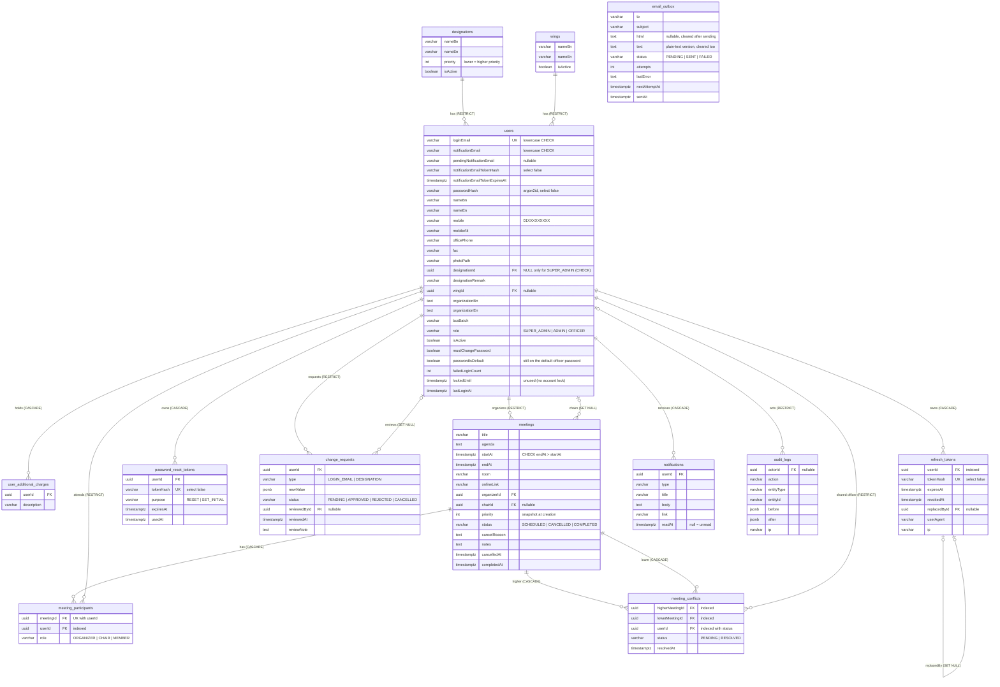

# Database ERD — BBS Meeting Schedule System

Source of truth: the TypeORM entities in `backend/src/modules/*/entities/` and **all** migrations in
`backend/src/database/migrations/` (list at the end). Business rules: [`SPEC.md`](../SPEC.md) §6–7.
Last checked against the code: 2026-11-13 (v1.0).

Every table also has `id uuid PK DEFAULT gen_random_uuid()`, `createdAt timestamptz` and
`updatedAt timestamptz` (left out of the boxes below to keep the diagram readable).
All date-times are `timestamptz` (stored in UTC). Status / role / type columns are `varchar`
holding TypeScript enum values (no native Postgres enums).

## Indexes

| Table | Index | Why |
|---|---|---|
| users | `UQ_users_loginEmail` (unique) | login lookup, one account per email |
| users | `CHK_users_designation_required` (check) | every account except the SUPER_ADMIN has a designation (= a meeting priority) |
| designations | `UQ_designations_nameEn_lower` (unique on `lower(nameEn)`) | no two designations with the same English name |
| wings | `UQ_wings_nameEn_lower` (unique on `lower(nameEn)`) | no two wings with the same English name |
| change_requests | `UQ_change_requests_one_pending` (unique on `userId, type` where `status = 'PENDING'`) | one pending request per type per officer |
| meetings | `IDX_meetings_startAt_endAt_status` | overlap search in the conflict engine, date-range lists |
| meeting_participants | `UQ_meeting_participants_meetingId_userId` (unique) | an officer is in a meeting at most once |
| meeting_participants | `IDX_meeting_participants_userId` | "which meetings is this officer in?" |
| meeting_conflicts | `IDX_meeting_conflicts_higherMeetingId`, `IDX_meeting_conflicts_lowerMeetingId` | conflicts of a meeting (detail page, auto-resolve) |
| meeting_conflicts | `IDX_meeting_conflicts_userId_status` | "my pending conflicts" |
| notifications | `IDX_notifications_userId_readAt` | bell list and unread count |
| refresh_tokens | `UQ_refresh_tokens_tokenHash` (unique), `IDX_refresh_tokens_userId` | find token on refresh; revoke all of a user's tokens |
| password_reset_tokens | `UQ_password_reset_tokens_tokenHash` (unique) | find token on reset |
| email_outbox | `IDX_email_outbox_status_nextAttemptAt` | worker picks due PENDING mail |

## Delete rules

- Users are **never hard-deleted** (deactivated instead). References that must keep history use
  `RESTRICT` (organizer, participant, shared officer, change-request owner, audit actor);
  optional references use `SET NULL` (chair, reviewer, replaced token).
- Data owned by a user goes with the user: additional charges, tokens, notifications (`CASCADE`).
- Data owned by a meeting goes with the meeting: participants, conflicts (`CASCADE`).
- A designation or wing cannot be deleted while any user uses it (`RESTRICT`).

## Migrations (in order)

| File | What it does |
|---|---|
| `1794196726794-InitialSchema` | all tables, foreign keys and the first indexes |
| `1794198728541-UserOrgAndMobileAlt` | `users.organization` → `organizationBn` / `organizationEn`; adds `mobileAlt`; designation required except for the SUPER_ADMIN |
| `1794202664020-UniqueDesignationWingNames` | case-insensitive unique English names for designations and wings |
| `1794203794672-ChangeRequestPendingUnique` | at most one PENDING change request per officer and type |
| `1794205166989-MailOutboxAndTokenPurpose` | `password_reset_tokens.purpose`; `email_outbox.text`; `html` nullable (bodies are purged after sending) |
| `1794214531030-MeetingConflictIndexes` | indexes on `meeting_conflicts` |
| `1794300000000-UserPasswordIsDefault` | `users.passwordIsDefault` (default officer password, owner decision 2026-11-09) |

Schema changes are made only through migrations (`synchronize` is always `false`):
`npm run migration:generate -- src/database/migrations/<Name>`, then `npm run migration:run`.
