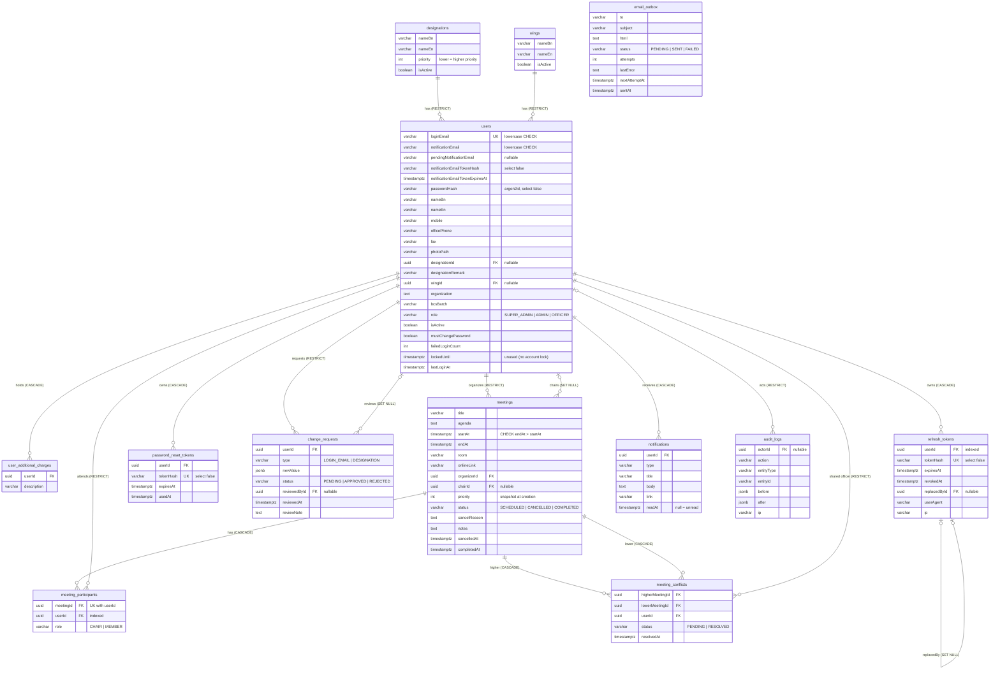

# Database ERD — BBS Meeting Schedule System

Source of truth: the TypeORM entities in `backend/src/modules/*/entities/` and the migration
`backend/src/database/migrations/*-InitialSchema.ts`. Business rules: [`SPEC.md`](../SPEC.md) §6–7.

Every table also has `id uuid PK DEFAULT gen_random_uuid()`, `createdAt timestamptz` and
`updatedAt timestamptz` (left out of the boxes below to keep the diagram readable).
All date-times are `timestamptz` (stored in UTC). Status / role / type columns are `varchar`
holding TypeScript enum values (no native Postgres enums).

## Indexes

| Table | Index | Why |
|---|---|---|
| users | `UQ_users_loginEmail` (unique) | login lookup, one account per email |
| meetings | `IDX_meetings_startAt_endAt_status` | overlap search in the conflict engine, date-range lists |
| meeting_participants | `UQ_meeting_participants_meetingId_userId` (unique) | an officer is in a meeting at most once |
| meeting_participants | `IDX_meeting_participants_userId` | "which meetings is this officer in?" |
| notifications | `IDX_notifications_userId_readAt` | bell list and unread count |
| refresh_tokens | `UQ_refresh_tokens_tokenHash` (unique), `IDX_refresh_tokens_userId` | find token on refresh; revoke all of a user's tokens |
| password_reset_tokens | `UQ_password_reset_tokens_tokenHash` (unique) | find token on reset |
| email_outbox | `IDX_email_outbox_status_nextAttemptAt` | worker picks due PENDING mail |

## Delete rules

- Users are **never hard-deleted** (deactivated instead). References that must keep history use
  `RESTRICT` (organizer, participant, shared officer, change-request owner, audit actor);
  optional references use `SET NULL` (chair, reviewer, replaced token).
- Data owned by a user goes with the user: additional charges, tokens, notifications (`CASCADE`).
- Data owned by a meeting goes with the meeting: participants, conflicts (`CASCADE`).
- A designation or wing cannot be deleted while any user uses it (`RESTRICT`).
